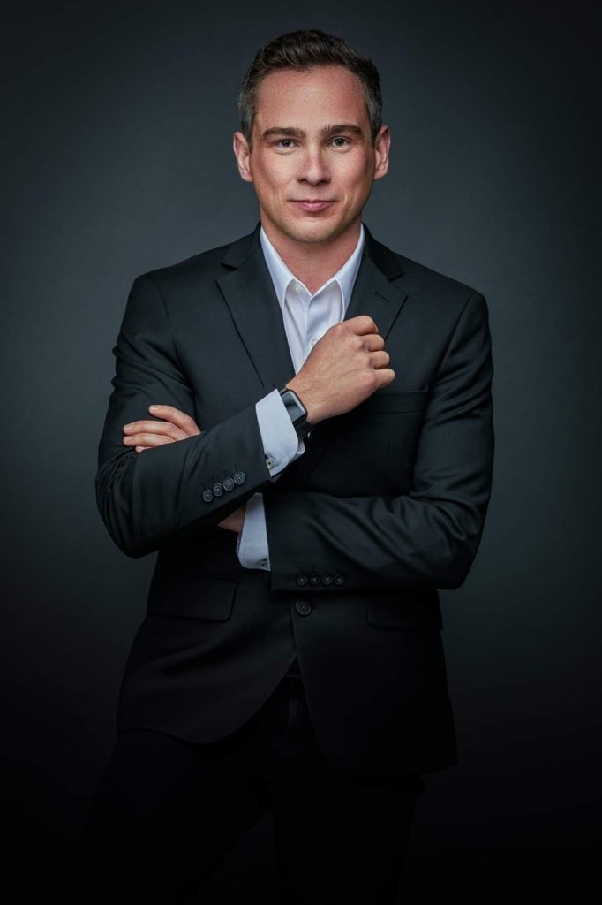
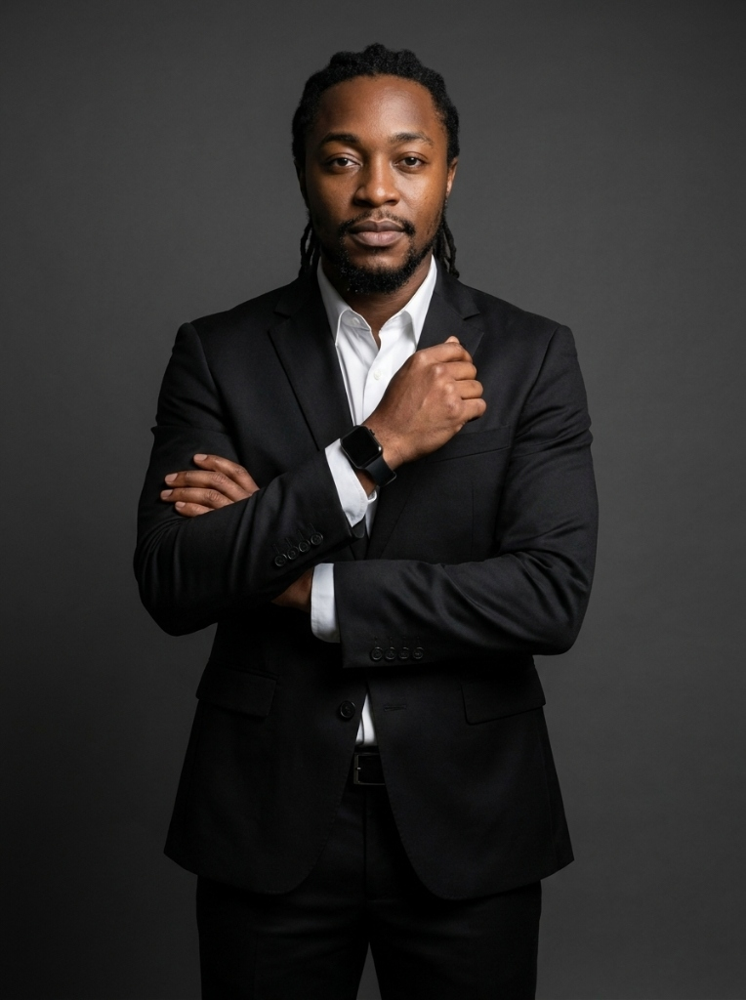

# Virtual Studio Portrait Pipeline: Zero-Slop Character Pose Replication

> **An Open-Source Generative Framework for Executive Portraiture, Reference Pose Cloning, and Character Consistency**  
> *Author:* **Sam Adeyinka** | Full-Stack Digital Marketing Specialist & High-Ticket Consultant  
> *Framework:* Applied Multimodal Diffusion & Optical Calibration

---

## 1. Executive Summary

Standard generative AI portraits routinely suffer from three frustrating failure modes:
1. **Plastic Epidermal Slop:** Algorithms default to aggressive airbrushing, eliminating natural pores, authentic melanin undertones, and skin texture.
2. **Identity Drift:** Swapping a subject's posture or wardrobe often alters their bone structure, eyes, and hair beyond recognition.
3. **Hand & Anatomy Breakdowns:** Complex stances such as crossed arms frequently produce mutated fingers, fused knuckles, or twisted wrists.

This repository provides a single, production-tested master prompt and structural workflow that extracts lighting and posture from reference photography and transfers them onto custom character identities with biological realism on the very first attempt.

---

## 2. Benchmark Visual Case Study

| Target Reference Pose | Calibrated AI Master Render |
| :---: | :---: |
|  |  |
| *Original reference photo used for lighting ratio and stance* | *Final generation preserving 100% biological features and wardrobe tailoring* |

---

## 3. How to Customize This Prompt for Your Own Face

The benchmark render in this repository maps my own real identity (Nigerian man, styled dreadlocks gathered back, clean hairline, groomed full beard). 

To adapt this prompt for yourself or a client without trial-and-error guessing, follow this simple 2-step reverse-engineering workflow:

### Step 1: Have Vision AI Extract Your Exact Physical Signature
Take a clear, unedited photo of your face, upload it to ChatGPT, Claude, or Google Gemini, and ask:
> *"Analyze this photo of me and write a concise, highly specific 3-sentence description of my physical appearance for a photo prompt. Focus strictly on facial bone structure, skin undertones, hair texture, and facial hair grooming style without flattering adjectives."*

### Step 2: Paste Your Description into the Master Prompt
Take the generated description and drop it directly into the first paragraph of the Master Prompt below, replacing my locs and beard details with your own.

---

## 4. The Unified Master Prompt (Copy & Paste)

You do not need multiple fragmented text files. This single consolidated prompt integrates camera physics, wardrobe tailoring, pose constraints, and negative guards into one unified block.

Attach 1 to 3 clear reference photos of your face, then paste this prompt into Google Flow (Nano Banana Pro), ChatGPT DALL-E, or Midjourney:

```text
A hyperrealistic commercial studio portrait of the person in [ATTACHED_FACE_REFERENCE], accurately preserving their real facial bone structure, natural eye shape, authentic skin undertones, and specific hairstyle: [INSERT YOUR EXTRACTED PHYSICAL DESCRIPTION HERE: e.g., neat styled dreadlocks gathered back with a clean hairline and groomed full beard].

STANCE & BODY LANGUAGE:
The subject is captured in an authoritative executive folded-arms power stance. The left forearm crosses the chest with the left hand resting naturally against the right upper arm, fingers relaxed with realistic joint curvature and zero digit deformation. The right arm crosses underneath to support the stance, shoulders square and broad, posture upright and composed. The subject looks directly into the camera lens with a calm, discerning, high-status expression.

WARDROBE & TEXTILE TAILORING:
Wearing a bespoke tailored jet-black wool two-button blazer with structured shoulders, sharp notched lapels, and visible textile fabric weave. Underneath is a crisp optical-white poplin spread-collar dress shirt, unbuttoned at the neck with a clean collar stand and no tie. On the left wrist is a modern matte-black digital smartwatch with a low-profile dark silicone band peeking out from the tailored shirt cuff.

LIGHTING PHYSICS & STUDIO ENVIRONMENT:
Photographed in a professional high-end studio setting against a seamless matte charcoal-grey cyclorama background with a soft, subtle radial vignette. Motivated 3-point studio lighting setup: a large 5600K diffused key light positioned 45 degrees camera-right delivering smooth, natural contrast across facial planes and subtle specular catchlights in both pupils; gentle neutral fill on the shadow side maintaining shadow detail; and a refined cool rim light contouring the shoulders and hair for distinct separation from the dark background.

OPTICAL CHARACTERISTICS & SENSOR PARAMETERS:
Shot on an 85mm portrait prime lens at f/2.8 on a medium-format digital sensor. Intentionally shallow depth of field rendering the eyes and facial features tack-sharp while allowing the background to fall into a smooth, creamy blur. 

INTEGRATED ANTI-SLOP & FIDELITY CONSTRAINTS:
Enforce true biological realism: visible epidermal micro-pores, natural skin moisture, fine facial hair stubble, realistic knuckle folds, and natural fingernail texture. Strictly forbid plastic skin smoothing, porcelain airbrushing, artificial beauty filters, synthetic skin sheen, extra fingers, fused digits, mutated hands, asymmetrical suit lapels, warped collars, cartoon stylization, floating artifacts, or low-resolution digital compression.
```

---

## 5. How to Use on Different AI Engines

### Method A: Google Flow (Nano Banana Pro / Omniflash)
1. Add your facial reference photos to the Flow canvas.
2. In the prompt field, reference your image token, paste the Master Prompt above, and insert your customized physical description.
3. Set the generation ratio to vertical `3:4` or `4:5` and generate.

### Method B: ChatGPT (Vision / Image Generation)
1. Upload your clear facial portrait.
2. Paste the entire Master Prompt directly into the prompt box.
3. ChatGPT will parse your facial geometry from the attachment and apply the lighting, suit tailoring, and power posture seamlessly.

### Method C: Midjourney v6
1. Upload your face image to Discord, copy its direct image link, and paste it at the beginning of the prompt.
2. Paste the Master Prompt immediately after the link.
3. Add `--ar 3:4 --v 6.0 --style raw` at the end of the prompt for maximum photographic realism.

---

## 6. Repository Structure

```text
virtual-studio-portrait-pipeline/
├── README.md                                          # Master documentation, visual case study, and customization guide
├── LICENSE                                            # Open-Source Attribution Permission
├── assets/
│   ├── reference_pose_source.jpg                      # Target reference photo for pose and lighting calibration
│   └── sam_adeyinka_virtual_studio_portrait.jpg       # Calibrated executive render
├── prompts/
│   └── 01_master_universal_studio_prompt.txt          # Unified copy-paste master prompt
└── workflows/
    └── pose_replication_pipeline.md                   # In-depth guide on extracting personal physical signatures
```

---

## 7. Author & Systems Profile

**Sam Adeyinka**  
*Full-Stack Digital Marketing Specialist & High-Ticket Consultant*  
- Second Brain & Applied AI Systems: Google Antigravity, Multimodal Creative Workflows, Paid Media Systems
- Official Portfolio: [samadeyinka.com/portfolio](https://samadeyinka.com/portfolio)  
- WhatsApp: `+234 816 164 6027`  
- Primary Email: [mailsam@samadeyinka.com](mailto:mailsam@samadeyinka.com)  
- Administrative Email: [samknowsfunnels@gmail.com](mailto:samknowsfunnels@gmail.com)  
- LinkedIn: [linkedin.com/in/thatsamadeyinka](https://www.linkedin.com/in/thatsamadeyinka/)  
